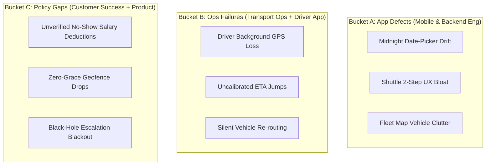

# 🚀 MoveInSync Employee App: Play Store Rating Turnaround & Systems Blueprint

<p align="center">
  
  
  
  
  
</p>

---

## 📑 Quick Navigation & Core Deliverables

- 📄 **[Full 12-Page Case Study Document (PDF)](docs/MoveInSync_FDE_PlayStore_Turnaround_Case_Study.pdf)** — *Publication-grade executive report.*
- 📖 **[Case Study Markdown Document](docs/CASE_STUDY.md)** — *Full interactive reading experience with Mermaid diagrams.*
- 🌐 **[Live Prototype Dashboard (Simulator)](dashboard/index.html)** — *Interactive simulation of the No-Show Evidence Card & Stale-GPS UI.*
- 🐍 **[Telemetry Engine (`ratings_pulse.py`)](telemetry-engine/ratings_pulse.py)** — *Automated weekly scraper & 10-theme NLP classifier.*
- 🛡️ **[No-Show Fairness Shield](fairness-engine/no_show_fairness_engine.py)** — *50m geofence lock, 180s dwell timer & 1-tap auto-reversal.*
- ⚡ **[Idempotent Booking Service](booking-service/idempotent_booking_api.py)** — *Distributed idempotency & transactional outbox pattern.*
- ⚙️ **[Automated Monday Cron Action](automation/ratings_pulse_automation.yml)** — *Weekly GitHub Actions execution.*

---

## 🎯 Executive Summary & The Core Systems Thesis

MoveInSync powers daily employee commutes for **1.5M+ daily riders across 430+ enterprise clients**. While B2B client retention remains strong, its public Google Play Store rating sits at **4.3★ across ~115,000 reviews**.

### The Core Systems Thesis
> **MoveInSync's rating is not primarily a cosmetic UI problem.**  
> The employee app is the only visible digital surface of an interdependent physical ecosystem spanning drivers, fleet vendors, dynamic routing engines, employer HR rosters, client transport desks, and payroll deduction rules.
>
> When a physical cab is late, when GPS drops, or when a driver erroneously marks a no-show, the employee has no control, cannot switch apps, cannot see who is accountable, and fears financial or disciplinary penalties. The Play Store review box becomes their sole escalation channel. The shared sentiment across hundreds of public reviews is:  
> **"The system is wrong about me, and I have no power to fix it."**  
> The rating is therefore a lagging indicator of **commute reliability, perceived fairness, and recovery speed**.

---

## 📊 The Mathematical Reality: Arithmetic of Rating Recovery

Any candidate promising a *"jump from 4.3★ to 4.7★ in 90 days on a lifetime base"* demonstrates mathematical illiteracy.

If Google Play calculated a pure arithmetic lifetime average, the number of consecutive net-new 5-star reviews ($x$) required to raise a rating from current average $r$ to target average $t$ over a lifetime base of $N$ ratings is governed by:

$$x = \frac{N \cdot (t - r)}{5 - t}$$

For MoveInSync, where $N \approx 115,000$ and $r = 4.3$:
- **To reach 4.4★:** $x = 115,000 \cdot \frac{4.4 - 4.3}{5 - 4.4} \approx \mathbf{19,166}$ pure 5★ reviews.
- **To reach 4.5★:** $x = 115,000 \cdot \frac{4.5 - 4.3}{5 - 4.5} \approx \mathbf{46,000}$ pure 5★ reviews.
- **To reach 4.6★:** $x = 115,000 \cdot \frac{4.6 - 4.3}{5 - 4.6} \approx \mathbf{86,250}$ pure 5★ reviews.
- **To reach 4.7★:** $x = 115,000 \cdot \frac{4.7 - 4.3}{5 - 4.7} \approx \mathbf{153,333}$ pure 5★ reviews (assuming zero 1-star reviews)!

### Strategic Forward Deployed Engineering Implication:
Because Google Play applies recency weighting to newer ratings, executive engineering leadership must align around:
1. **Trailing 30-Day Average Rating** (sensitive to recent releases).
2. **Weekly 1-Star Review Share WoW** (leading indicator of severe operational friction).
3. **Leading Operational Metrics** ($p95$ GPS staleness, disputed no-show rate, booking idempotency errors).

---

## 🔍 The Diagnostic Framework: 3 Buckets, 3 Owners



### Ranked Failure Modes & Remediation Architecture

| Failure Mode | Strength | Root Cause | Engineering Solution |
| :--- | :---: | :--- | :--- |
| **No-Show Disputes & Salary Penalties** | **HIGH** | Drivers mark absent without verified geofence dwell; employees suffer unexpected salary deductions. | **No-Show Fairness Shield:** 200m push nudge, mandatory 180s dwell lock, 1-tap evidence dispute auto-reversal. |
| **Live Telemetry & GPS Inaccuracy** | **HIGH** | Driver OEM aggressive battery management kills background GPS; app shows frozen pins as live. | **Honest Telemetry UI:** Display *"Updated 35s ago"*, ETA confidence bands (*"8–12 min"*), adaptive WebSocket heartbeat. |
| **Booking Integrity & Boundary Bugs** | **MEDIUM** | Night-shift date-picker drift around midnight ($23:30–00:30$); retries creating duplicate bookings. | **Idempotent Booking API:** `Idempotency-Key` header, transactional outbox pattern, CI timezone boundary tests. |
| **UX Regressions & Map Clutter** | **MEDIUM** | Shuttle booking changed from 1 to 2 steps; live map renders all fleet vehicles instead of assigned cab. | **Client-Side Fleet Filter:** Render assigned polyline only; restore 1-tap shuttle re-booking flow. |
| **Silent Escalation Black Hole** | **MEDIUM** | Feedback travels Employee $\rightarrow$ Ops $\rightarrow$ Transport Desk $\rightarrow$ MoveInSync with zero employee visibility. | **In-App Progress Tracker:** Live ticket timeline + 48h personalized human review triage SLA. |

---

## 🛡️ Production Services & Architecture

### 1. No-Show Fairness & Auto-Reversal Engine (`fairness-engine/`)
Addresses the #1 emotional driver of 1-star ratings.
- **Haversine Geofence Lock:** Disallows drivers from marking no-show unless verified within 50m of pickup coordinates.
- **180s Stationary Dwell Timer:** Enforces that drivers must wait at least 3 minutes before attendance marking is enabled.
- **Evidence Card Generator:** Displays cryptographic audit trail (who marked absent, wait duration, driver distance).
- **1-Tap Auto-Reversal:** Automatically evaluates employee disputes against audit logs and revokes HR salary deductions instantly.

```bash
# Run the fairness engine test harness
python3 fairness-engine/no_show_fairness_engine.py
```

### 2. Distributed Idempotent Booking Service (`booking-service/`)
Protects against duplicate bookings and midnight roster drift:
- **`Idempotency-Key` Header:** Caches transaction results to ensure cellular retries return idempotent responses.
- **Transactional Outbox Pattern:** Guarantees that trip state and notification dispatch are committed atomically.

```bash
# Run the idempotent booking test harness
python3 booking-service/idempotent_booking_api.py
```

### 3. Automated Ratings Pulse Telemetry (`telemetry-engine/`)
Answers *"How are our Play Store ratings?"* in one auditable command:
- Ingests recent reviews across multiple locales (`en_IN`, `en_AU`, `en_CA`).
- Runs multi-label NLP regex taxonomy to classify issues into 10 categories.
- Routes shifts directly to assigned squad owners.
- Computes trailing-30d rating, velocity, and 1-star share WoW.

```bash
# Run the Ratings Pulse scraper
pip install google-play-scraper pandas tabulate
python3 telemetry-engine/ratings_pulse.py --app com.moveinsync.ets --count 1000 --out telemetry-engine/pulse_out
```

---

## 📋 Start-Tomorrow Jira Engineering Backlog

```
RP-1:  Export Google Play Console 90-Day Telemetry (FDE / Product)
RP-2:  Automate Ratings Pulse Weekly Cron (FDE / DevOps)
RP-3:  Establish 48h Review Response Triage SLA (Customer Success)
RP-4:  Suppress Rating Prompts on Disputed/Late Trips (Mobile Eng)
RP-5:  Implement Stale-GPS Indicator & Confidence Band (Android / iOS Eng)
RP-6:  Driver App Geofence Dwell & Proximity Lock (Driver App Eng)
RP-7:  Pre-Pickup Geofence Proximity Push Notification (Backend Platform)
RP-8:  One-Tap No-Show Dispute & Auto-Reversal (Mobile + Backend)
RP-9:  Idempotent Booking API & Transactional Outbox (Core Backend Eng)
RP-10: Client-Side Assigned Fleet Vehicle Map Filter (Mobile Eng)
RP-11: Midnight Shift Boundary Date-Picker Fix (Mobile + Backend)
RP-12: Native Google In-App Review Flow Integration (Android Eng)
```

---

## 🧪 Falsifiable Decision Rules ("What Would Change My Mind")

| If Day-1 Telemetry Shows... | Pre-Committed Architectural Pivot | Assigned Owner |
| :--- | :--- | :--- |
| Disputed No-Show complaints account for **$<10\%$** of 1–2★ reviews. | Demote R4/R8 engineering effort; retain simple UI quick wins and re-allocate capacity to GPS telemetry. | Product / FDE |
| GPS / ETA / Telemetry complaints account for **$>35\%$** of 1–2★ reviews. | Pull forward adaptive WebSocket heartbeats and driver telemetry into Sprint 1; establish dedicated live-tracking squad. | Engineering Lead |
| Crash-Free Users drop below **$99.0\%$** or ANR rate exceeds **$0.47\%$**. | Halt all feature work immediately (P0 freeze). Stability and memory leak profiling take complete precedence. | Mobile Lead |
| Low ratings heavily concentrated in 1 or 2 Android OEMs (e.g. Xiaomi / Vivo). | Prioritize OEM-specific aggressive background battery-whitelisting guides in onboarding flows. | Android Eng |
| Personalized review replies convert **$<5\%$** of detractors to updated ratings. | Re-evaluate reply copy, response latency, and resolution effectiveness; shift focus entirely to core product prevention. | Customer Success |

---

## ⚙️ CI/CD Automation (GitHub Actions)

This repository includes a scheduled GitHub Actions workflow [`automation/ratings_pulse_automation.yml`](automation/ratings_pulse_automation.yml) running on cron:
- **Schedule:** Every Monday at `03:00 UTC` (**08:30 AM IST**).
- Automatically triggers `telemetry-engine/ratings_pulse.py`.
- Generates `pulse_digest.md` and commits the updated telemetry back to the repository.

---

## 👨‍💻 Forward Deployed Engineer Day-1 Commitments

If selected as MoveInSync's Forward Deployed Engineer:
1. **Shadow Ops Control-Room Shifts:** Spend the first two evening shifts (18:00–02:00) directly alongside MoveInSync dispatchers and client transport desk managers.
2. **Stand Up Ratings Pulse by Day 2:** Connect Google Play Console API, execute the telemetry pipeline, and publish the verified baseline dashboard.
3. **Figma Interactive Prototypes by Day 5:** Deliver clickable prototypes of the *Stale-GPS Map State*, *Evidence Card*, and *1-Tap Dispute Flow*.
4. **Zero-Regression Staged Deployments:** Ensure every single mobile release follows strict canary gates with automated rollbacks on any Android Vitals regression.

---

<p align="center">
  <b>Built for MoveInSync by Ankur Choudhary</b> &bull; Forward Deployed Engineer Candidate<br>
  <a href="docs/MoveInSync_FDE_PlayStore_Turnaround_Case_Study.pdf">Download Executive PDF</a> &bull; <a href="docs/CASE_STUDY.md">Read Case Study Online</a>
</p>
