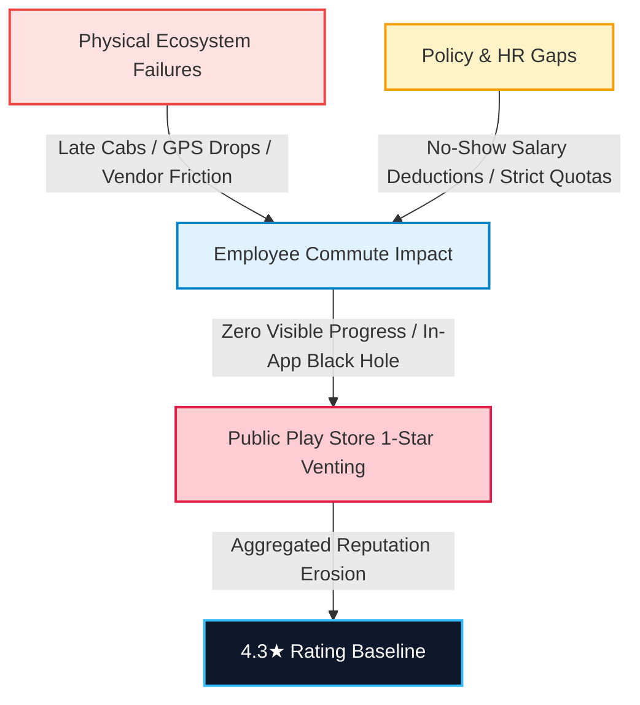
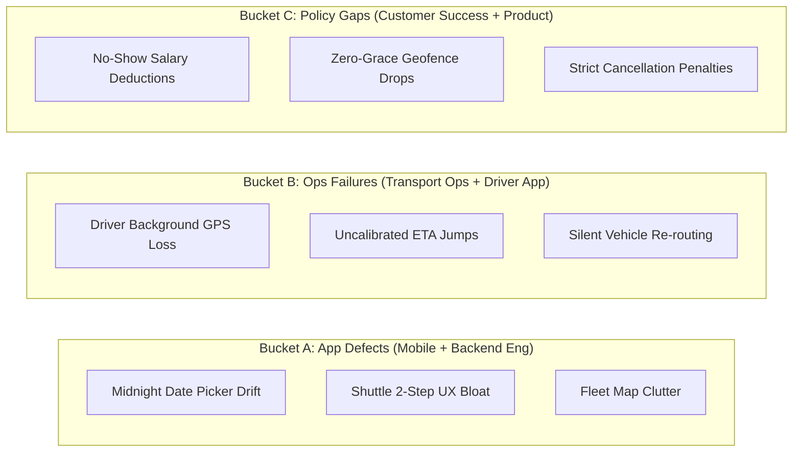

# MoveInSync: Fixing the Rating, Not Just the Number
## A Systems-Engineering & Operational Turnaround for the MoveInSync Employee App
**Author:** Ankur Choudhary ([@Ankurchoudhary75](https://github.com/Ankurchoudhary75))  
**Role:** Forward Deployed Engineer (Intern to FTE) Candidate Assignment  
**Target Package:** `com.moveinsync.ets` (Android Employee App)  
**Historical Base:** ~115,000 Lifetime Reviews | 1.5M+ Daily Commuters | 430+ Enterprise Clients  
**Official Document:** [Download Complete 12-Page PDF](MoveInSync_FDE_PlayStore_Turnaround_Case_Study.pdf)

---

## 1. Executive Summary & Core Thesis

### The Core Systems Thesis
> **MoveInSync's Play Store rating is not primarily a cosmetic UI problem.**  
> The employee mobile app is the only visible digital surface of an interdependent physical ecosystem spanning drivers, fleet vendors, dynamic routing engines, employer HR rosters, client transport desks, and payroll deduction rules.
>
> When a physical cab is late, when GPS drops, or when a driver erroneously marks a no-show, the employee has no control, cannot switch apps, cannot see who is accountable, and fears financial or disciplinary penalties. The Play Store review box becomes their sole escalation channel. The shared sentiment across hundreds of public reviews is:  
> **"The system is wrong about me, and I have no power to fix it."**  
> The rating is therefore a lagging indicator of **commute reliability, perceived fairness, and recovery speed**.



### Where We Stand: Portfolio Health & Upstream Bottlenecks
MoveInSync powers mission-critical daily commutes for marquee Fortune 500 enterprises. While B2B client retention remains strong, companion apps show upstream strain:
- **Employee App (`com.moveinsync.ets`):** 4.3★ (~115,000 reviews).
- **Driver Partner App (`com.moveinsync.driver.dco`):** **3.5★**. Drivers are the sole source of real-time GPS telemetry and attendance confirmation. A weak driver app degrades employee tracking.
- **Workplace Kiosk (`com.workinsync.meeting`):** **3.4★**. Reflects localized hardware friction.
- **Historical Precedent:** MoveInSync's engineering blog previously documented a rating slide from 4.6★ down to 4.3★ during hypergrowth, which was reversed by abandoning automated canned bots and deploying personalized human review replies that converted detractors into 5★ advocates.

---

## 2. Ranked Failure Modes by Evidence Strength

| Failure Mode | Evidence Level | Operational & Emotional Impact | Direct Remediation Style |
| :--- | :---: | :--- | :--- |
| **No-Show Disputes & Salary Deductions** | **HIGH** | Employees marked "No-Show" after a late cab or sudden geofence departure. Generates immediate corporate salary deductions. *Anger + money loss guarantees 1-star reviews.* | Pre-pickup nudges, driver dwell locks, 1-tap evidence dispute. |
| **Live Telemetry & GPS Inaccuracy** | **HIGH** | Frozen GPS pins, erratic ETA jumps (e.g. 5 min jumping to 25 min), vehicles passing pickup points invisibly. Destroys the foundational promise of live tracking. | Adaptive heartbeat, honest stale-state UI, dead-reckoning smoothing. |
| **Booking Integrity & Boundary Bugs** | **MEDIUM** | Bookings scheduled for unintended dates (especially around midnight shift cutoffs 23:30–00:30) or recurring roster desync, leaving employees stranded without a cab. | Idempotent booking API, explicit confirmation sheet, CI boundary tests. |
| **UX Regressions & Map Clutter** | **MEDIUM** | Shuttle booking bloated from 1-step to multi-step wizard; live tracking screen rendering all fleet vehicles in the slot rather than filtering to the assigned vehicle polyline. | Client-side map vehicle filtering, 1-tap shuttle re-booking, staged rollouts. |
| **Black-Hole Escalation Pipeline** | **MEDIUM** | Feedback travels through Employee → Ops → Client Transport Desk → MoveInSync. The employee sees no ticket progress, so the public Play Store becomes their megaphone. | In-app transparent status timeline, 48h personalized triage SLA. |

---

## 3. The Arithmetic of Rating Recovery

### Mathematical Proof: Why 4.3★ → 4.7★ in 90 Days on a Lifetime Base is Impossible
If Google Play calculated a pure arithmetic lifetime average, the number of consecutive net-new 5-star reviews ($x$) required to raise a rating from current average $r$ to target average $t$ over a lifetime base of $N$ ratings is governed by:

$$x = \frac{N \cdot (t - r)}{5 - t}$$

For MoveInSync, where $N \approx 115,000$ and $r = 4.3$:
- **To reach 4.4★:** $x = 115,000 \cdot \frac{4.4 - 4.3}{5 - 4.4} \approx \mathbf{19,166}$ pure 5-star reviews.
- **To reach 4.5★:** $x = 115,000 \cdot \frac{4.5 - 4.3}{5 - 4.5} \approx \mathbf{46,000}$ pure 5-star reviews.
- **To reach 4.6★:** $x = 115,000 \cdot \frac{4.6 - 4.3}{5 - 4.6} \approx \mathbf{86,250}$ pure 5-star reviews.
- **To reach 4.7★:** $x = 115,000 \cdot \frac{4.7 - 4.3}{5 - 4.7} \approx \mathbf{153,333}$ pure 5-star reviews (assuming zero 1-star reviews)!

> **Forward Deployed Engineer Conclusion:**  
> Any applicant promising a 4.7★ lifetime rating in 90 days does not understand mathematics. Because Google Play applies recency weighting to newer reviews, engineering leadership must focus on **Trailing 30-Day Average Rating**, **Weekly 1-Star Review Share**, and leading operational metrics.

---

## 4. The Diagnostic Framework: 3 Buckets, 3 Owners



### Commute Journey Failure Map
1. **Booking:** Multi-step wizard confusion & midnight date drift $\rightarrow$ *Fix: Idempotent Booking API, explicit confirmation sheet, 5-min undo.*
2. **Pre-Pickup:** Stale GPS, erratic ETA jumps, map cluttered with all fleet cabs $\rightarrow$ *Fix: Client-side vehicle filtering, honest stale-data indicator, ETA confidence intervals.*
3. **Waiting:** Cab departs early; employee marked absent $\rightarrow$ *Fix: 200m geofence push nudge, 3-minute mandatory stationary dwell lock.*
4. **Boarding:** Cellular dead zone prevents OTP sync $\rightarrow$ *Fix: Offline-first SQLite local caching for OTP and SOS tokens.*
5. **In-Transit:** Route deviation or unmonitored night transit $\rightarrow$ *Fix: One-touch SOS, anomaly detection, emergency operations dispatch integration.*
6. **Support:** Black-hole complaint pipeline $\rightarrow$ *Fix: In-app transparent timeline (Raised $\rightarrow$ Transport Desk $\rightarrow$ Auto-Reversed).*

---

## 5. The 4 Solution Pillars

### Pillar 1: Honest & Trustworthy Telemetry Experience
- **Never Present Stale Data as Live:** If vehicle coordinates are $>30\text{s}$ old, display *"Driver location updated 35s ago"* and desaturate the cab icon. If stale $>90\text{s}$, transition to an amber banner.
- **Confidence-Interval ETAs:** Replace falsely exact numbers with dynamic ranges: *"Estimated arrival: 8:12 – 8:17 AM"*.
- **Adaptive Heartbeat:** 15s in transit, accelerating to 3s within 1 km of pickup.
- **Client-Side Fleet Filtering:** Render exclusively the polyline and license plate of the assigned cab.

### Pillar 2: The No-Show Fairness & Anti-Penalty Shield
- **200m Proximity Nudge:** Audible push notification when cab is 2 minutes away: *"Your cab is arriving. Tap to check in."*
- **Backend Verification Guardrail:** Disallow drivers from marking absent unless vehicle GPS is verified within 50m and stationary dwell $\ge 180\text{s}$.
- **Evidence Card & 1-Tap Auto-Reversal:** Displays driver wait time and distance; employee dispute automatically validated against telemetry logs and payroll deduction revoked.
- **Prompt Suppression:** Instantly suppress rating prompts on trips with disruptions, delays $>10\text{m}$, or disputed no-shows.

### Pillar 3: Distributed Booking Integrity & Offline Resiliency
- **Idempotency-Key Header (`uuidv4`):** Prevents duplicate bookings during network retry bursts.
- **Transactional Outbox Pattern:** Trip state and notification outbox committed atomically in a single ACID transaction.
- **Offline-First SQLite Cache:** Pre-caches OTP verification hashes and emergency SOS tokens for basement dead zones.

### Pillar 4: Transparent Recovery & Ethical Review Harvesting
- **48-Hour Personalized Play Review Triage Rota:** SLA to reply to 100% of 1–3★ reviews with specific trip investigation details (never canned platitudes).
- **Google In-App Review API Integration:** Prompt satisfied employees *strictly after an OTP-verified on-time drop* for users with $\ge 3$ clean trips and zero recent disputes (capped at 120-day frequency).

---

## 6. Start-Tomorrow Jira Engineering Backlog

```
RP-1:  Export Google Play Console 90-Day Telemetry (FDE / Product)
RP-2:  Automate Ratings Pulse Weekly Cron (FDE / DevOps)
RP-3:  Establish 48h Review Response Triage SLA (Customer Success)
RP-4:  Suppress Rating Prompts on Disputed/Late Trips (Mobile Eng)
RP-5:  Implement Stale-GPS Indicator & Confidence Band (Android / iOS Eng)
RP-6:  Driver App Geofence Dwell & Proximity Lock (Driver App Eng)
RP-7:  Pre-Pickup Geofence Proximity Push Notification (Backend Platform)
RP-8:  One-Tap No-Show Dispute & Auto-Reversal (Mobile + Backend)
RP-9:  Idempotent Booking API & Transactional Outbox (Core Backend Eng)
RP-10: Client-Side Assigned Fleet Vehicle Map Filter (Mobile Eng)
RP-11: Midnight Shift Boundary Date-Picker Fix (Mobile + Backend)
RP-12: Native Google In-App Review Flow Integration (Android Eng)
```

---

## 7. Falsifiable Decision Rules ("What Would Change My Mind")

| If Day-1 Telemetry Shows... | Pre-Committed Architectural Pivot | Assigned Owner |
| :--- | :--- | :--- |
| Disputed No-Show complaints account for **$<10\%$** of 1–2★ reviews. | Demote R4/R8 engineering effort; retain simple UI quick wins and re-allocate capacity to GPS telemetry. | Product / FDE |
| GPS / ETA / Telemetry complaints account for **$>35\%$** of 1–2★ reviews. | Pull forward adaptive WebSocket heartbeats and driver telemetry into Sprint 1; establish dedicated live-tracking squad. | Engineering Lead |
| Crash-Free Users drop below **$99.0\%$** or ANR rate exceeds **$0.47\%$**. | Halt all feature work immediately (P0 freeze). Stability and memory leak profiling take complete precedence. | Mobile Lead |
| Low ratings heavily concentrated in 1 or 2 Android OEMs (e.g. Xiaomi / Vivo). | Prioritize OEM-specific aggressive background battery-whitelisting guides in onboarding flows. | Android Eng |
| Personalized review replies convert **$<5\%$** of detractors to updated ratings. | Re-evaluate reply copy, response latency, and resolution effectiveness; shift focus entirely to core product prevention. | Customer Success |

---

## 8. Forward Deployed Engineer Day-1 Commitments
1. **Shadow Ops Control-Room Shifts:** Spend the first two evening shifts (18:00–02:00) directly alongside MoveInSync dispatchers and client transport desk managers.
2. **Stand Up Ratings Pulse by Day 2:** Connect Google Play Console API, execute the telemetry pipeline, and publish the verified baseline dashboard.
3. **Figma Interactive Prototypes by Day 5:** Deliver clickable prototypes of the *Stale-GPS Map State*, *Evidence Card*, and *1-Tap Dispute Flow*.
4. **Zero-Regression Staged Deployments:** Ensure every single mobile release follows strict canary gates with automated rollbacks on any Android Vitals regression.
